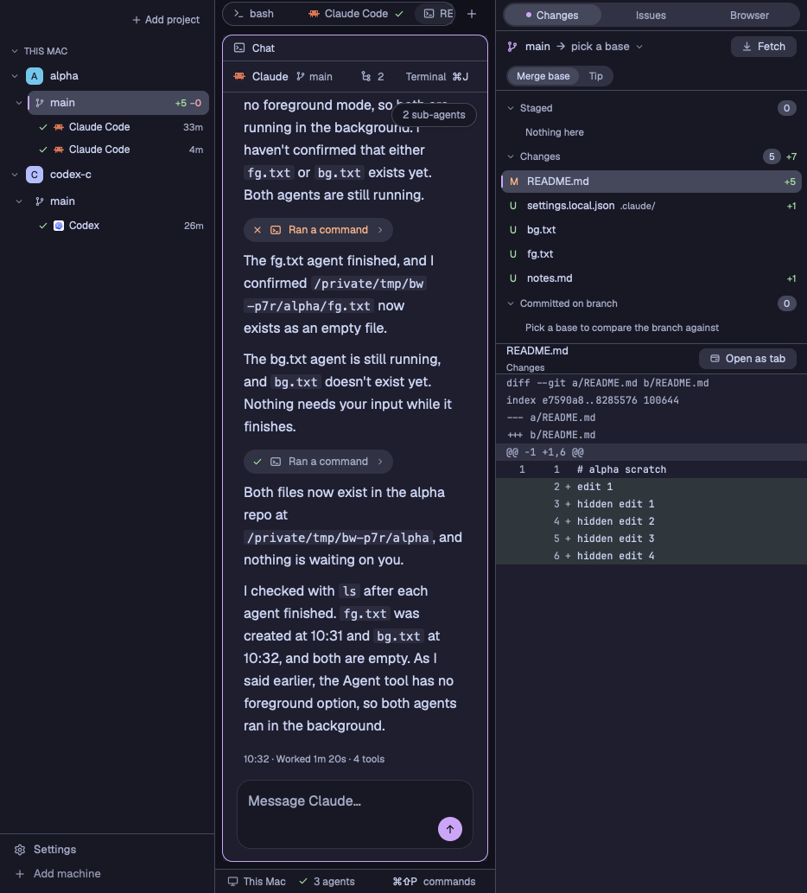
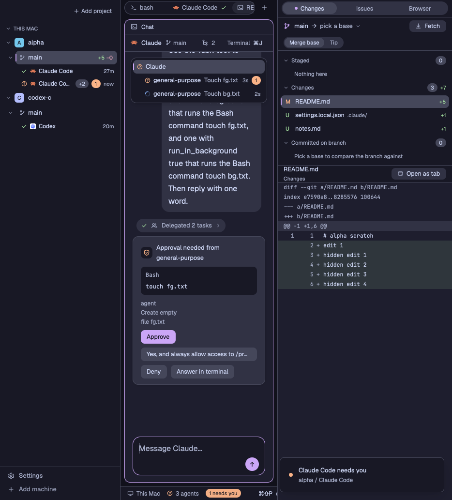
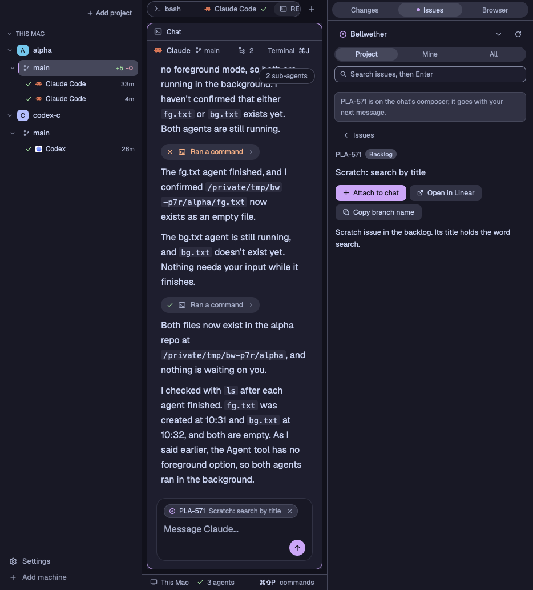
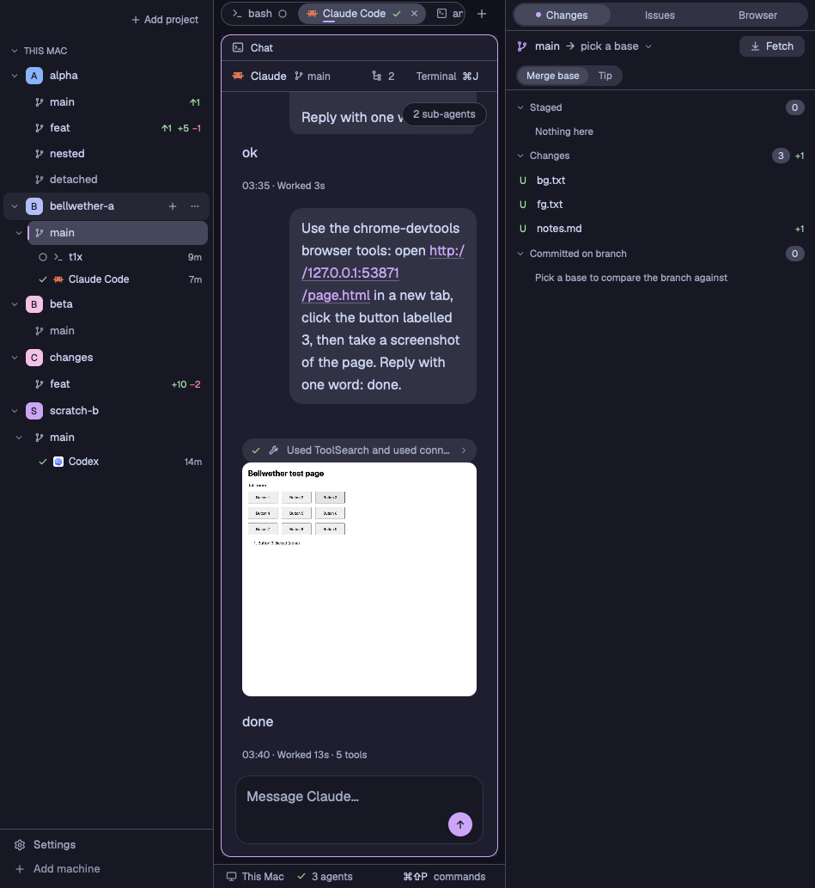

# Bellwether

Bellwether is a layout and a set of mods for the [Herdr app](https://herdr.dev) that turn Herdr into
a workbench for coding agents. It adds five things to the window:

- The left sidebar lists each machine's Git projects, every worktree with its ahead, behind and
  `+N −M` counts, and the agents running in each worktree with a live status mark.
- A Claude or Codex agent started from "+" opens as a chat tab. The chat draws the agent's session
  log as bubbles, Markdown and one-line tool summaries, and `⌘J` flips to the real terminal.
- Approvals and questions from the agent and its sub-agents appear as request cards that you answer
  in the chat.
- The right sidebar's Changes panel shows the worktree's Git diff against `origin/main` or a ref you
  pick, and its Issues panel shows the Linear project linked to the repository.
- The right sidebar's Browser panel shows a separate Google Chrome that you and the agents share.

A Rust helper, `bw`, reads session logs, screens and Git on whichever machine a space lives on. The
mods draw the window and call `bw` for the work.

## Screenshots









## Requirements

- The machine that shows the Herdr window runs macOS, because the browser and window code call
  `osascript` and AppKit.
- The Herdr app is installed. It brings the `herdr-app` and `hc` commands.
- Rust is installed through rustup, which reads the toolchain from `rust-toolchain.toml`.
  [Bun](https://bun.sh), `jq` and `rsync` are installed too.
- Claude Code or Codex runs on each machine where you start agents.
- The Browser panel needs Google Chrome, and each machine whose agents use it needs Node with `npx`.
- The Issues panel needs a Linear personal API key.

Spaces can also live on other machines that `hc` reaches: an Apple silicon Mac, or Linux on x86_64
or aarch64.

## Install

Open the Herdr app once so that its app home, `~/.config/herdr-app`, exists. Then, from a clone of
this repository:

```sh
scripts/install-helper.sh              # build bw and install it on this machine
scripts/sync.sh                        # copy the layout, its theme and the bw-* mods into the app home
scripts/check.sh                       # check every mod
bun scripts/keys-merge.js              # show the key bindings it would add
bun scripts/keys-merge.js --apply      # add them, after saving a backup of keys.json
herdr-app do layout.switch '{"name":"bellwether"}'
```

Run the same steps on every machine that shows a Herdr window. To use the Issues panel, store your
Linear key in this Mac's Keychain once:

```sh
scripts/linear-key.sh   # paste the key at the prompt, which does not echo
```

[docs/usage.md](docs/usage.md#install) covers each step, the key bindings, and set-up for spaces on
other machines.

## First use

1. Open a space in a Git folder, or click "Add project" in the sidebar and pick a folder. The
   project, its worktrees and their counts appear in the sidebar.
2. Click "+" in the tab bar and choose New chat → Claude or Codex. The agent starts in a new tab,
   and the chat opens beside its terminal.
3. Type in the composer and press Enter. Press `⌘J` to flip between the chat and the terminal.
4. When the agent asks for approval, answer the card above the composer, or choose Answer in
   terminal.
5. Use the right sidebar's strip to switch between Changes, Issues and Browser. `cmd-alt-b` hides and
   shows the right sidebar.
6. In Issues, click the header to link the repository to a Linear project. Attach to chat puts an
   issue on the chat's composer.

The first chat on a machine without Bellwether's hooks shows a notice in the request dock. Review
changes shows the edit to the Claude and Codex hook files, and Apply makes it. The hooks let a card
name the sub-agent that asked. [Hooks](docs/usage.md#hooks) explains the notice and the Codex trust
step.

## The bw helper

The mods run `~/.local/share/bellwether/helper/current/bw`, which `scripts/install-helper.sh`
installs. This window needs helper version 0.7.0 and protocol 7. When the helper on another machine
is missing or outdated, the window copies this Mac's `bw` there through `hc` and checks again. To do
it yourself:

```sh
bw machine status <machine>    # current, missing, outdated, unreachable or no_build
bw machine install <machine>   # copy this machine's bw there
```

A Linux machine gets the build that `scripts/build-dist.sh` writes, which needs `cargo zigbuild`.
[docs/helper.md](docs/helper.md) lists every `bw` command and what it prints.

## Known limits

- A chat tab's terminal keeps about 15 columns while the chat is zoomed in a window under 1000 px
  wide. At that width a Codex sub-agent's approval card offers only Answer in terminal.
- Claude started on another machine by an `hc` core that SSH started cannot read that machine's
  login Keychain, so it runs logged out. Start that machine's core from its own login session.
- An agent's browser tools need Node and `npx` on its machine, and a machine that `hc` reaches
  through `via` gets no browser. Arrange works on macOS only.
- The Linear key lives in one Mac's Keychain. Run `scripts/linear-key.sh` on each Mac that shows the
  window.
- A diff opened as a tab does not refresh by itself. Its Refresh button reads it again.

[docs/usage.md](docs/usage.md#known-limits) lists every known limit.

## Documentation

- [docs/usage.md](docs/usage.md) covers installing and using each part of the window.
- [docs/helper.md](docs/helper.md) is the `bw` command reference.
- [docs/architecture.md](docs/architecture.md) explains the pieces, where each runs and how they
  talk.
- [docs/development.md](docs/development.md) is the reference for changing the code: the repository
  map, tests, verify scripts and release steps.
- [docs/README.md](docs/README.md) indexes every doc, including the design history.
- [RECIPE.md](RECIPE.md) is the layout's recipe: what the window shows, how it behaves and what it is
  built from.

## License

Bellwether is MIT licensed; see [LICENSE](LICENSE). Code adapted from other projects keeps its
notice in [THIRD_PARTY_NOTICES.md](THIRD_PARTY_NOTICES.md).
