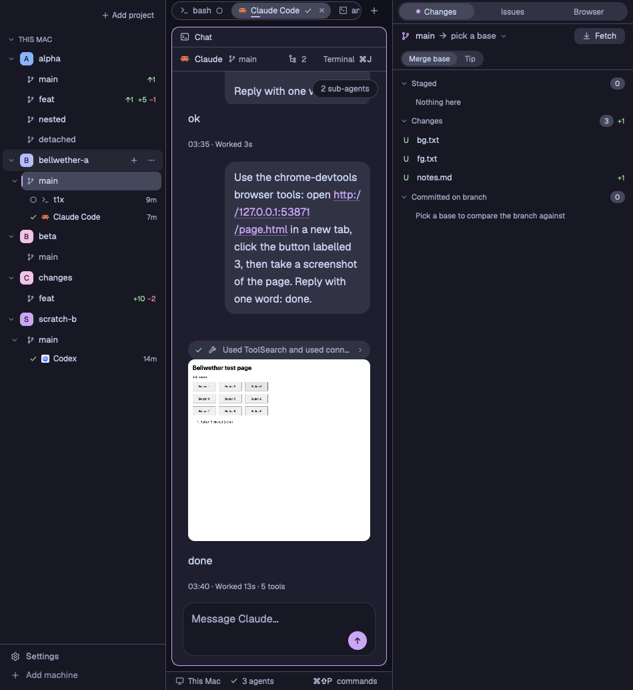

# Bellwether

A three-column Herdr window in Catppuccin Mocha with a Mauve accent. On the left, every machine lists
its Git projects, each project its worktrees with ahead, behind and `+N −M` counts, and each worktree
the agents running in it with a live status mark. In the middle, a floating tab capsule sits over the
active tab, each pane wears a header with its program, folder and status, and a status bar runs
along the bottom. An agent started from "+" opens as a chat: its session log drawn as bubbles,
Markdown and one-line tool summaries, with approval and question cards you can answer in place, and
`⌘J` flips to the real terminal behind it. On the right, one strip switches between Changes (a Git
diff against `origin/main` or a chosen ref), Issues (the Linear project linked to the repository)
and Browser (a separate Google Chrome that you and the agents share).



## What you see

The whole window draws in the layout's own theme, `themes/bellwether.json`. It stays dark whatever
the system appearance. Window colours by role: canvas Crust `#11111b`, chrome Mantle `#181825`,
surface and pane background Base `#1e1e2e`, raised Surface 0 `#313244`, border and selected
Surface 1 `#45475a`, input edge Overlay 1 `#7f849c`, hover `#cdd6f414`, text `#cdd6f4`, muted
Subtext 0 `#a6adc8`, dim Overlay 2 `#9399b2`, accent Mauve `#cba6f7` with Crust text on it. Status
colours: working Blue `#89b4fa`, blocked Peach `#fab387`, done Green `#a6e3a1`, idle Overlay 2
`#9399b2`. Failures use Red `#f38ba8`. Secondary text on a Surface 1 fill moves to Subtext 1
`#bac2de`. Terminals use Ghostty 1.4.0's Catppuccin Mocha ANSI colours, cursor Rosewater `#f5e0dc`,
a `#494060` selection (a quarter of Mauve over Base) and 14 by 12 px padding. Columns have 1 px
Surface 1 dividers, and there is no title bar.

Left to right:

1. The left sidebar is Mantle, 248 px wide, and resizes from 160 to 480 px. A 46 px header holds
   "+ Add project" at its right; on macOS it leaves 76 px for the window buttons. Under it, each
   machine has a 26 px heading in 11 px semibold capitals with a fold chevron and, when needed, a
   pill such as "offline", "connecting…" or "setting up Bellwether". Each project is a 32 px row:
   chevron, a 20 px letter tile (Crust letters on one of nine Mocha hues picked by a hash of the
   project, so it keeps its colour), and the name in 13 px semibold. Each worktree is a 30 px row
   with a branch icon, its branch name in 13 px, and in 11 px `↑ahead` in Green, `↓behind` in Red,
   `+added` in Green and `−removed` in Red. Under a worktree, each agent is a 26 px line in 12 px:
   status mark, program icon, title, a `+N` pill for running sub-agents, a Peach pill with the
   number of waiting requests, and its age ("now", "5m", "3h", "2d"). Spaces outside any project
   list under "Other spaces". The active space's worktree has a Surface 1 fill and a 2 px Mauve bar;
   one with no open space reads in Subtext 0. Narrower than 160 px the sidebar becomes a rail of
   28 px letter tiles with 10 px status marks, Surface 1 for a project with no open space.
2. A 69 px footer under the sidebar is Herdr's `workspace-chrome` footer: Settings, Add machine.
3. The middle column has a 32 px Crust tab bar at the top. The tabs sit in a capsule 28 px tall with
   a Mantle fill, a 1 px Surface 1 border and 14 px corners. Each tab is 24 px tall with 12 px
   corners and 12.5 px text: program icon, title cut at 170 px, status mark, and a machine pill for
   a space on another machine. The active tab has a Surface 1 fill, Text colour, a 14 by 2 px Mauve
   underline and an 18 px close button. Other tabs read in Subtext 0, and a settled tab is italic.
   A ghost "+" button follows the capsule.
4. Under the tab bar, the active tab fills an area with 8 px padding. Panes are cards 8 px apart
   with 12 px corners, a Base fill, a 1 px Surface 1 border and a 1 px Mauve border when focused,
   even when a tab has only one pane. Each pane has a 30 px header in 12 px: status mark (agents
   only), program icon, the program or title (Text when focused, else Subtext 0, cut at 260 px),
   the folder with the home shortened to `~`, a breathing Peach "Needs you" pill while the agent is
   blocked, and four 22 px round buttons: Split right, Split down, Zoom or Unzoom, Close.
5. A 28 px Mantle status bar runs under the tab with a 1 px top border and 12 px Subtext 0 text:
   the space's machine ("This Mac" for this one), its branch, a status mark of the most urgent agent
   with "N agents", a Peach "N needs you" pill while any agent is blocked, and at the right the
   command palette's key and "commands" (for example "⌘⇧P commands").
6. A chat pane has a 36 px header: program icon, the agent's name in 13 px semibold, its branch, a
   machine pill when remote, a threads button with the sub-agent count, and "Terminal ⌘J". The
   reading column is at most 736 px wide. Your messages are Surface 0 bubbles (16 px corners, at most
   80 % of the column); replies are Markdown. Each run of tool calls is one 28 px Surface 0 chip such
   as "Read 3 files and ran 2 commands", Peach when a call failed, and a turn that edited files ends
   with "Changed 2 files · Open in Changes". Pictures show inline up to 320 px tall. The composer is
   a Mantle box ("Message Claude…") with a 28 px round send button, Mauve when it can send. Request
   cards stack above it, at most 45 % of the pane. A 312 px threads card floats at the top right.
7. The right sidebar is Mantle, 360 px wide, and resizes from 280 to 900 px. Its 36 px strip holds a
   28 px Surface 0 track with three 24 px segments: Changes, Issues, Browser. The chosen one has a
   Surface 1 fill, Text in medium weight and a 6 px Mauve dot.
8. Changes shows a 36 px header such as `feat → origin/main ▾  9d6c68d · 3d` with a Fetch button,
   then a "Merge base | Tip" switch, then three foldable sections (Staged, Changes, Committed on
   branch), each with its file count and `+N −M`. File rows are 26 px: a status letter (`A` and `U`
   Green, `D` and `!` Red, `R` and `C` Blue, `M` Peach), the file name in 12.5 px, its folder, and
   counts or "binary". The selected file's patch fills the lower part, up to 42 % of the panel and at
   least 140 px: 20 px lines in the person's terminal font (JetBrains Mono when none is set) at
   11.5 px, two 40 px line-number columns, added lines on `#a6e3a11f`, removed lines on `#f38ba81f`,
   hunk headers on Surface 0, and "Open as tab".
9. Issues shows the linked project's name (or "Link a Linear project") with a Mauve issue icon and a
   chevron, a refresh button, a 26 px "Project | Mine | All" track and a search field "Search
   issues, then Enter". Issues group under 26 px headings (an 8 px Mauve dot, the state in capitals,
   the count), one 30 px row each with a 64 px identifier column and the title. An opened issue
   shows identifier, state, labels, the title in 15 px semibold, the description as Markdown, and
   Attach to chat, Open in Linear and Copy branch name.
10. Browser shows a 36 px header: a Mauve Chrome icon, "Bellwether Chrome", a state pill ("Running ·
    6 tabs" on Mauve, "Not running" on Surface 0, a port clash on Peach, a failure on Red), and
    24 px round New tab and Arrange buttons, or Start. Each Chrome tab is a 40 px row: a 24 px
    favicon tile, title in 13 px, host and path in 11 px; the active one has a Surface 1 fill and a
    2 px Mauve bar. A FORWARDS section lists each SSH forward with a state pill (Green ready, Red
    failed, Peach otherwise), a Stop button, and a Mauve "Forward port" control.

Menus and dialogs are Mantle cards with 12 px corners, a 1 px Surface 1 border and a shadow. The
"+" menu (232 by 300 px) has New chat (Claude, Codex), New terminal (Shell, Claude, Codex) and
Worktree (New worktree…, Open worktree…) in 30 px rows. The project menu (248 px) has New worktree…,
Open worktree…, Link Linear project… and Remove. Add project (420 by 220 px) has a machine switch, a
32 px path field, Choose… on this Mac, Cancel and a Mauve Add button.

## How it behaves

Agent status draws the same in the sidebar, the tabs, the pane headers, the chat and the status bar.
Working is a Blue arc that spins once every 900 ms. Blocked is a Peach question mark whose opacity
breathes from 0.65 to 1 over 1400 ms, and the "Needs you" pills breathe with it. Done is a Green
check that fades in over 180 ms. Idle is a still Overlay 2 ring. Any other status draws an empty box
of the same size. A folded project or worktree shows its most urgent agent's mark (blocked, then
done, then working, then idle). Menus, dialogs and request cards fade in over 140 ms and slide up
6 px, once, and hover fills fade over 120 ms. An idle window does not move.

Sidebar: a click on a worktree selects its first space, or opens a new space in that folder. A click
on an agent line selects its space and tab and focuses that agent. A chevron or heading folds, and
folds survive a reload. Hovering a project shows "+" and "⋯"; "⋯" or a right-click opens the project
menu, whose Remove says "close its spaces first" while a space is open. An unreachable machine keeps
its last rows.

Tabs: a click selects, a drag onto another tab moves it there (a 2 px Mauve bar marks the drop), and
the close button closes the active tab. In "+", a Claude or Codex row shows a spinner and "Preparing
browser…" for up to 20 s, then starts the agent.

Chats: "+" → New chat → Claude starts Claude in a new tab, then a chat pane opens to the right of its
terminal, zoomed. `⌘J` or "Terminal ⌘J" swaps zoom and focus between chat and terminal. The chat
reads the log every 2 s while shown and every 10 s while hidden. Enter sends and Shift-Enter adds a
line. A send that no longer matches the agent's conversation (after `/clear` or `/new`, or while a
prompt waits) is refused and the text stays. Scrolling to the top loads older rows. A tool chip
lists its calls on click. "Open in Changes" selects the Changes panel and, for one file, that file. A
click on a sub-agent shows its transcript with a 44 px bar such as "Explore · sub-agent of Claude ·
running · Back to Claude". The threads card folds to a pill such as "2 sub-agents · 1 asks" when no
sub-agent runs or asks.

Request cards: an approval offers Approve, Always allow (when the prompt has it), Deny and Answer in
terminal. A question has step tabs, options with 1 to 9 key hints (a digit selects and never
submits), checkboxes for a multi-select, an Other field and Submit. Buttons stay disabled while the
chat's terminal has focus and for 3 s after. A resolved card stays 10 s.

Right sidebar: a strip segment shows its panel and remembers the choice per space (Changes by
default), and `⌘⌥B` hides and shows the whole column. In Changes, the header opens a base picker (up
to 200 refs, filtered as you type), Fetch runs `git fetch` for the base's remote, a click on a file
shows its patch, "Show more" loads its next page, and "Open as tab" opens a middle tab such as
`notes.txt · diff` with its own Refresh. In Issues, the header opens the link picker, the track and
Enter re-read the list, "Load more" reads the next 50, and Attach to chat puts the issue as a chip on
the active chat's composer; at Send each chip becomes the issue's title, URL and description ahead of
your text. In Browser, a row focuses that Chrome tab, its hover × closes it, and Arrange places
Chrome beside the Herdr window. A click on "commands" in the status bar opens the command palette.

## Built from

Node tree of `layouts/bellwether.json` (root `theme: "bellwether"`, `titlebar: "none"`,
`traffic_lights: [12, 16]`, `background: "canvas"`, `terminal_padding: [14, 12]`, 1 px `border`
divider, `preview: "layouts/bellwether.svg"`):

```text
root (row)
├── sidebar (column, 248 px, min 160, max 480, chrome)
│   ├── projects        block  mod bw-projects
│   └── sidebar-footer  block  69 px  mod workspace-chrome {footer: true}
├── work (column, resizable false)
│   ├── tabs       block  32 px  window_drag  mod bw-tabs
│   ├── work-body  row  padding 8  gap 8
│   │   └── main   block  tab "active", pane {gap 8, radius 12, background "background", lone true,
│   │              border 1 "border", focus 1 "accent", header {mod bw-pane, height 30, top, reveal "always"}}
│   └── status     block  28 px  mod bw-status
└── right (column, 360 px, min 280, max 900, chrome)
    ├── right-strip  block  36 px  mod bw-right
    └── right-body   stack  active "changes"
        ├── changes  block  mod bw-diff
        ├── issues   block  mod bw-linear
        └── browser  block  mod bw-browser
```

Every mod's `mod.json` has `"place": "none"`. Overlays open with `frame: "none"` and draw their own
card. Mods and their `props`:

1. `bw-projects`, no props: the sidebar. It also calls `setAgentOrder` so Herdr's agent order matches.
2. `bw-tabs`, no props: the tab bar. It also adopts new chat tabs (`pane.split` of `bw-chat` to the
   right of the agent's terminal, then `pane.zoom`) and handles its command `chat-flip`.
3. `bw-pane`, `{pane, terminal}` from Herdr: the pane header.
4. `bw-status`, no props: the status bar.
5. `bw-right`, no props: the strip. With `{panel}` it draws a placeholder the layout no longer uses.
6. `bw-diff`, no props: the Changes panel. As a middle tab (`tab.new {mod: "bw-diff"}`) it takes
   `{tab: true, space, machine, window, top, section, file, old, untracked, from, to, base, mode}`.
7. `bw-linear`, no props: the Issues panel. As the 440 by 500 px link dialog it takes
   `{pick: {machine, commonDir, name}}`.
8. `bw-browser`, no props: the Browser panel.
9. `bw-chat`, `{terminal, machine, kind, window}`: a chat pane; `kind` is `claude` or `codex`.
10. `bw-new`, `{space}` from the tab bar or `{machine, folder}` from a project: the "+" popup.
11. `bw-menu`, `{project: {key, machine, commonDir, main, name, open}}`: the project popup.
12. `bw-add`, no props: the Add project dialog.

Shipped Herdr mods used: `workspace-chrome` (footer) and `worktree` (New and Open worktree dialogs at
460 by 280 and 560 by 480 px).

`herdr` functions: `spaces`, `panes`, `agents`, `terminals`, `machines`, `focused`, `layout`,
`props`, `theme`, `keys`, `window`, `home`, `settings`, `shared`, `setShared`, `exec` (with
`{ on: space.machine }`), `watchFolder`, `pickFolder`, `knownAgents`, `nextCommand`, `openOverlay`,
`closeOverlay`, `notify`, `setAgentOrder`, `run`; plus `cx.open_url`, `cx.write_to_clipboard` and
`localStorage` for folds. Commands run: `space.new`, `space.select`, `tab.new`, `tab.select`,
`tab.move`, `tab.close`, `pane.split`, `pane.zoom`, `pane.focus`, `pane.close`, `agent.focus`,
`layout.select {stack: "right-body", child}`, `terminal.peek`, `app.palette`. Keys in
`keys/bellwether.json`, section `layout:bellwether`: `cmd-alt-b` → `layout.toggle:right`, `cmd-j` →
`bw-tabs.chat-flip`. Shared values: `bw.projects`, `bw.chat-tabs`, `bw.chat-shown`,
`bw.terminal-focus`, `bw.window-id`, `bw.known-agents`, `bw.right.tab`, `bw.diff.base`,
`bw.diff.reveal`, `bw.linear.links`, `bw.chat.attach`, `bw.hooks-dismissed`.

Shared JavaScript lives in `shared/`: `palette.js` holds every colour, `ui.js` the status marks,
pills, chips, letter tiles, cards and buttons, and the rest the helper client, project model,
refresh schedule, Git parsing and chat-tab logic. Each `mods/bw-*/.shared` lists what a mod imports.

Programs: mods run `git` for short reads and the Rust helper `bw` through `exec("sh", …)` at
`~/.local/share/bellwether/helper/current/bw` on the space's machine (`$BW_HELPER` here when set).
`bw` commands: `version`,
`machine status|install|setup`, `feed`, `locate`, `send`, `picture`, `picture-read`, `tree`, `cards`,
`answer`, `counts`, `hooks`, `event`, `browser` (`up`, `down`, `status`, `tabs`, `focus`, `close`,
`new`, `arrange`, `agent-args`, `forward …`, `free-port`, `port-check`), `agent` (`ensure`, `args`,
`warm`), `diff files|patch|refs|fetch` (and the detached `diff watch`), and `linear
projects|issues|search|issue`. `bw` in turn runs `git`, `hc` (`exec`, `get`, `send`, `put`, kept
terminals for forwards), `security find-generic-password -s bellwether.linear` and `/usr/bin/curl`
for Linear, Google Chrome through `open -n` with its own profile and DevTools on 127.0.0.1:9222,
`ssh -R` for remote agents, and `npx -y chrome-devtools-mcp@1.12.0` as each agent's `bw-browser`
MCP server. `hooks/bw-event` is an optional Claude and Codex hook that hands events to `bw event`.

Art: one-colour SVG icons in each mod's `icons/` folder, tinted by `text_color` (the status ring,
ring-spin, check and question live in `mods/bw-projects/icons/`), and `layouts/bellwether.svg`, a
640 by 400 preview.

## Watch out

- Herdr rewrites its shipped layouts, mods and its own `AGENTS.md` on every start. Build in a
  separate folder and copy in with `scripts/sync.sh`, which writes only `layouts/bellwether.*`,
  `themes/bellwether.json` and `mods/bw-*/`, as real files: Herdr loads no SVG through a symlink.
- A mod cannot import outside its own folder. `scripts/sync.sh` copies each `shared/` file into
  every mod whose `.shared` names it, and `scripts/check.sh` fails when a copy differs. Icon paths
  do cross folders (`shared/ui.js` uses `mods/bw-projects/icons/`), so install all twelve mods.
- `exec` returns once, with a 30 s and 8 MiB cap, no standard input and no streaming. Anything that
  watches a log or a remote worktree runs in `bw`, and a mod polls it. Every Git call is short and
  read-only: `--no-optional-locks`, `-c core.fsmonitor=false`, `--no-ext-diff --no-textconv`.
- Mods run on the machine showing the window. `watchFolder` and `pickFolder` work only there; a
  remote space needs `exec(..., { on: space.machine })`. `space.new` without `machine` means the
  focused space's machine, so this Mac is named `machine: ""`.
- Herdr draws only shown copies of a mod. A hidden panel must make no helper call: Changes, Issues
  and Browser check that their stack child is active and their last read was drawn, else park.
- `render` has no `cx` and loop tasks never read live data: render hands the loop its targets and
  pokes it. There is no `setTimeout`.
- A transition animates only a later change: draw a card at opacity 0 and set 1 on its first
  `on_size_change`. Virtual list rows take no handlers, so chat chip hovers are `.hover` swaps.
- No mod file other than `shared/palette.js` holds a colour literal. `themes/bellwether.json` is
  written from it by `bun scripts/gen-theme.js`, and `tests/theme.test.js` keeps them equal.
  Subtext 0 on Surface 1 falls under 4.5:1, so selected rows use Subtext 1 and the bright Red.
- `shared/helper.js` requires `bw version` to report 0.7.0 and protocol 7. When another machine's
  helper is missing or older, a mod runs this Mac's `bw machine install <machine>` and checks again.
  An Apple silicon Mac gets the running `bw`; Linux needs `scripts/build-dist.sh` (`cargo zigbuild`);
  other platforms report `no_build`.
- A remote Changes panel polls every 1.5 s through `bw diff files --watch`. The watcher must start
  without `HC_SCOPE` and in its own process group, or the `hc exec` that started it ends it. It
  exits after 60 s with no call, and `diff-unchanged` is trusted only while its process lives.
- The Linear key lives in this Mac's login Keychain under service `bellwether.linear`, stored once
  per Mac with `scripts/linear-key.sh`. Only `bw linear` reads it, and it reaches curl through its
  config on standard input. No mod, shared value, argument, log or cache may hold it.
- A chat sends with `bw send` on the space's machine with the terminal's local address: `hc send`
  from another core wraps the text in `<hc from=…>` and slash commands stop working.
- A terminal binding of `cmd-j` wins while a terminal has focus; `scripts/keys-merge.js` reports it
  as shadowed and refuses to replace a key already bound elsewhere.
- A zoomed chat's terminal keeps its share of the split, about 15 columns under 1000 px, so a long
  Codex approval falls back to "Answer in terminal". Herdr has no command to size a pane.
- The browser needs Node and `npx` where the agent runs, gives a machine reached through `via` no
  browser, and Arrange works on macOS only. After the Bellwether Chrome restarts, a running agent's
  browser tools stop until its next session. Bellwether never touches the person's own Chrome.
- Over SSH, reading Desktop, Documents or Downloads on a Mac raises a privacy prompt on that Mac's
  screen, so probes that walk a home folder skip them.
- Without the optional hooks, requests show without who asked; Codex runs a new hook only once the
  person trusts it. Changes lists at most 2,000 files per section, counts no untracked file over
  64 MiB, and a diff tab does not refresh by itself. Mine and All show every project's issues.
- A covered window stops drawing, so `herdr-app shot` returns the last frame drawn. Bring the window
  to the front first.
- The in-window checks for the sidebar, tabs, chats, requests, browser, Changes and Issues ran on
  one Mac, and the repository's README lists what they found under Known limits. The in-window
  checks on a space on a second machine are still owed.

## Done when

- `scripts/test.sh` prints `all tests passed`: cargo fmt, clippy and tests, `bunx biome ci`,
  `bunx tsc -p types`, `bun test`, `scripts/check.sh` and every `scripts/verify/*.sh --offline`.
- `scripts/check.sh` runs the real `herdr-app check` on all twelve mods with no `STAND-IN` or `FAIL`
  line, `bun scripts/gen-theme.js --check` passes, and `grep -rnoE "#[0-9a-fA-F]{6}" mods/bw-*/*.js
  shared/*.js` finds colours only in `palette.js` and its copies.
- After `scripts/sync.sh` and `herdr-app do layout.switch '{"name":"bellwether"}'`, `herdr-app status`
  reports layout `bellwether` with no errors and no `layout.error` or `keys.error` file appears.
- `herdr-app shot` shows a 248 px Mantle sidebar, a Crust tab bar with the capsule, framed panes with
  30 px headers, the 28 px status bar and the 360 px right sidebar with Changes selected; pixels
  sampled from each region equal the role colours above within 2 per channel.
- `scripts/verify/projects.sh --offline` passes: sidebar rows equal `git worktree list`, a closed row
  opens its exact folder, and counts follow an edit within 2 s.
- "+" → New chat → Claude opens a tab whose chat pane is zoomed beside the terminal, and `⌘J` flips
  to the terminal and back. `scripts/verify/sessions.sh --offline` and
  `scripts/verify/requests.sh --offline` pass.
- `scripts/verify/git.sh` passes, and the Changes header reads `<branch> → origin/main` in a
  repository that has `origin/main`. `scripts/verify/linear.sh` passes against Linear with a stored
  key (`--offline` without one) and finds no part of the key in any file it scans.
- `scripts/verify/browser.sh --offline` passes, and the Browser panel says "Not running" with Start
  before Chrome runs and "Running · N tabs" after.
- In the `scripts/verify/stage.sh up` window, `helper-calls.log` gains a `feed` line every 2 s for a
  shown chat and every 10 s for a hidden one, and none for a hidden panel.
- An agent printing a blocked status makes its marks breathe Peach in the sidebar, tab, pane header
  and status bar, the "N needs you" pill appears, and with every agent idle ten shots 150 ms apart
  are identical.
