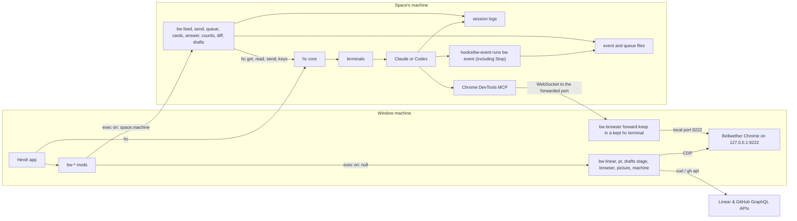

# Architecture

Bellwether has three parts: a Herdr layout, fifteen `bw-*` mods that draw the window, and a Rust
helper, `bw`, that does every read and write that is slow, needs a long-lived process, or has to run
on the machine a space lives on. This page says which part owns what, how the parts talk, and where
each runs. [helper.md](helper.md) lists each `bw` command's flags and output lines;
[development.md](development.md) gives the steps for editing, syncing and testing.

## The main flow

## Herdr and the app home

The Herdr app (`herdr-app`) draws the window. herdr-core (`hc`) runs every terminal and agent, and
keeps them running when the window closes. Herdr loads layouts, themes and mods from its app home,
`~/.config/herdr-app` (or `$HERDR_APP_HOME`), and rewrites its own shipped files there on every
start. `scripts/sync.sh` copies Bellwether's files into the app home; the repository's folders
mirror the app home's, so the copy is plain.

### The layout

`layouts/bellwether.json` was cloned from Herdr's `main` layout (version 0.1.13). Its root is a row
with the `bellwether` theme (`canvas` `#1e1e2e`) and three columns:

| Column | Size | Slots and the mod that fills each |
|---|---|---|
| `sidebar` | 244 px, 200 to 420 | `projects`: `bw-projects`. `sidebar-footer` (40 px): Herdr's `workspace-chrome` with `{ "footer": true }`. |
| `work` | the rest, not resizable | `tabs` (48 px, `window_drag: true`): `bw-tabs`. `screen`, a stack of `["chat", "panes", "needs", "overview"]` starting on `chat`, with a left-edge `floating` drawer `sidebar-peek` (`bw-projects` `{ "peek": true }`, `peek: 6`). `panes` renders the active tab with `lone: false` and a hover-revealed 28 px `bw-pane` header. |
| `right` | 380 px (`hidden: true`), 280 to 620 | `right-strip` (36 px): `bw-right`. `right-body`, a stack starting on `changes`: `changes` is `bw-diff`, `issues` is `bw-linear`, `drafts` is `bw-drafts`, `browser` is `bw-browser`. |

`bw-new`, `bw-menu` and `bw-add` open as overlays, and `bw-status` remains checked for custom
layouts.

### Theme and keys

`themes/bellwether.json` is the layout's own theme, written from `shared/palette.js` by
`scripts/gen-theme.js` using flattened Catppuccin Mocha steps (`Base` `#1e1e2e` for `canvas` and
`surface`, `Mantle` `#181825` for `chrome`, `#272738` for `raised`, `#333546` for `selected`, and
neutral `TILE_HUES`). `keys/bellwether.json` binds six keys in `layout:bellwether`: `cmd-b`
(`layout.toggle:sidebar`), `cmd-j` (`bw-tabs.chat-flip`), `cmd-shift-'` (`bw-tabs.terminal-peek`),
`cmd-shift-n` (`bw-tabs.needs-toggle`), `cmd-shift-o` (`bw-tabs.overview-toggle`), and `cmd-alt-b`
(`layout.toggle:right`). `scripts/keys-merge.js` merges them into the app home's `keys.json`.
[development.md](development.md) covers the palette and contrast checks.

## Mods

Every mod follows one pattern. `render` reads Herdr's live data (`spaces()`, `panes()`,
`terminals()`, `agents()`, `focused()`, `layout()`) and hands targets to one loop task. The loop
task sleeps, wakes on a poke from `render` or on its timer, and runs `exec`. The Issues, Changes and
Drafts loops also read `layout()` before each call and park while their panel is hidden, because the
render a strip click causes can arrive before the stack switches. `REVIEW.md` makes the rest a
rule: a mod must not poll `agents()`, `spaces()`, `panes()`, `terminals()` or `focused()`, animate
with a timer, or block on `exec`. Motion uses Herdr's own animation, with `loop("opacity")`
restricted strictly to the top-bar `Needs you` count pill.

| Mod | Shows | Owns |
|---|---|---|
| `bw-projects` | left sidebar and left-edge peek drawer | Each machine's projects with every Git worktree, its ahead and behind counts, its `+N −M` change counts, and one line per agent with `+N` sub-agents and a request badge. It runs Git on each space's machine through `shared/git.js` and `bw counts` per machine. |
| `bw-tabs` | 48 px top bar | Two 36 px floating capsules: space tabs and "+" on the left, and `Chat` / `Panes`, the breathing `Needs you` pill, `Overview`, and the inspector toggle on the right. Mirrors `screen.active` into `shared("bw.screen")`, tracks per-tab `bw.tab-view`, hands focus to `panes`, `bw-chat`, or `bw-needs`, and records when terminal focus left (`bw.terminal-focus`). |
| `bw-new` | overlay from "+" | The "+" menu: a single-pane Claude or Codex chat, a shell or agent terminal on `panes`, and Herdr's New worktree and Open worktree dialogs. |
| `bw-right` | 36 px strip over the right inspector | The Changes, Issues, Drafts and Browser segmented strip plus `×` (`layout.hide`). A click runs `layout.select` on `right-body` and stores the choice per space. |
| `bw-menu` | overlay from a project | A project's menu: worktree dialogs, Link Linear project (opens `bw-linear` with `{ pick }`) and Remove. |
| `bw-add` | overlay from the sidebar header | The Add project dialog: pick a machine and a folder, and `git rev-parse` there finds the repository it belongs to. |
| `bw-status` | standalone status bar | Retained status bar mod for custom layouts. |
| `bw-pane` | each multi-pane terminal's hover header | The agent's status, the program, its title and folder, and split right, split down, zoom and close buttons. |
| `bw-chat` | `chat` screen (or per-pane harness copy) | Frameless conversation view with a 24-session LRU `SessionMap`, multi-agent switcher (`bw.chat-agent`), 1-line PR strip (`bw pr status`), per-terminal prompt queue (`bw queue`), sub-agent threads, request dock, and composer. |
| `bw-needs` | `needs` screen | Two-column cross-space triage (`Needs you`, `Ready to land`, `Working`, `Idle`) with inline `1-9` and `Other…` answers (`bw answer`), `Waiting in terminal` fallback, pinned `Open chat`, and PR skill actions. |
| `bw-overview` | `overview` screen | Cross-space fleet grid with neutral monograms, machine badges, branch + PR badges, and one-click jumps to `chat` or `panes`. |
| `bw-diff` | Changes panel, or a middle tab | `Uncommitted`, `Branch`, and `PR` scopes for the active space's worktree, line-anchored comments (`on_item_click` + retained composer bar), `±5` line relocation, and unselected-file preflight `bw diff patch` verification before `bw send` or `bw queue add`. |
| `bw-linear` | Issues panel, or the link picker | The open Linear issues of the linked project, an issue view, the link picker (with `{ pick }`) and Attach. |
| `bw-drafts` | Drafts panel | Read-only worktree HTML artifacts (`Open in Browser` with `bw drafts stage --machine` for remote spaces), header-parsed 6-column `decisions.tsv` and `.audit/*.tsv` trails, plan checklists (`docs/plans/*.md`, `tasks.md`), and allow-listed `ledger.md` Markdown. |
| `bw-browser` | Browser panel | The Bellwether Chrome's state, tabs and forwards. |

### Shared state

Mods talk to each other only through Herdr's `shared(key)` and `setShared(key, value)`. Every mod
sees each value, Herdr keeps it in the app home's `shared.json`, and setting one re-renders every
mod.

| Key | Written by | Read by | Holds |
|---|---|---|---|
| `bw.projects` | `bw-projects`, `bw-add`, `bw-menu` (Remove) | the same three | The remembered projects, `{ version: 1, projects }`. |
| `bw.chat-tabs` | `bw-new` (a pending chat), `bw-tabs` | `bw-tabs`, `bw-new`, `bw-chat`, `bw-needs`, `bw-diff` | Each chat tab's space, machine, kind and terminal, plus pending chats. |
| `bw.screen` | `bw-tabs` | `bw-chat` | One-way mirror of `screen.active` so `bw-chat` drops poll cadence from 2 s to 10 s while off `chat`. |
| `bw.tab-view` | `bw-tabs`, `bw-new`, `bw-needs`, `bw-overview` | `bw-tabs` | Per-tab preferred view (`"chat"` or `"panes"`). |
| `bw.chat-agent` | `bw-chat`, `bw-needs`, `bw-overview`, `bw-projects` | `bw-chat`, `bw-diff` | `{ [tabId]: terminalAddress }`, pinning which agent `bw-chat` targets in a multi-agent tab. |
| `bw.pr-summary` | `bw-chat`, `bw-needs`, `bw-diff` | `bw-tabs`, `bw-overview`, `bw-diff` | Per-space cached GitHub PR summary for top-bar `Needs you` counts and fleet badges. |
| `bw.window-id` | `bw-tabs` | `bw-tabs`, `bw-chat`, `bw-diff` | This app home's id, so a diff tab knows whether this window made it. |
| `bw.chat-shown` | `bw-tabs` | `bw-chat` | Shown chat panes in per-pane mode. |
| `bw.terminal-focus` | `bw-tabs` | `bw-chat`, `bw-needs` | When focus last left each terminal, for the [focus guard](#answering). |
| `bw.known-agents` | `bw-new` | `bw-new` | The agents each machine last reported, keyed by machine (`""` for this Mac). |
| `bw.right.tab` | `bw-right`, `bw-chat`, `bw-needs`, `bw-drafts` | `bw-right` | `{ [spaceId]: panelId }`, the right sidebar panel per space. |
| `bw.diff.base` | `bw-diff` | `bw-diff` | Each project's base and mode under `projectKey(machine, commonDir)`. |
| `bw.diff.reveal` | `bw-chat`; `bw-diff` drops it | `bw-diff` | `{ [spaceId]: { file, at } }`, the file "Open in Changes" named. |
| `bw.linear.links` | `bw-linear` | `bw-linear` | Each repository's linked Linear project. |
| `bw.chat.attach` | `bw-linear` (add), `bw-chat` (remove, mode, size) | `bw-chat`, `bw-linear` | Attached issue chips, keyed by the chat's tab id. |
| `bw.hooks-dismissed` | `bw-chat` | `bw-chat` | The machines whose hooks notice got Not now. |

`bw-projects`, `bw-diff`, and `bw-drafts` keep folded sections in `localStorage`, which no other mod
reads.

### Shared JavaScript

A mod cannot import outside its own folder. Code used by several mods lives in `shared/`, and each
`mods/bw-*/.shared` lists the `shared/` files that mod imports, one name per line. `scripts/sync.sh`
copies each listed file beside the mod's `main.js` in the repository before it copies the mods into
the app home. `scripts/check.sh` fails while a copy is missing or differs from its source.
[development.md](development.md) gives the steps.

## Machines and where code runs

Each machine runs its own hc core, which keeps that machine's terminals and its spaces' layout.
Herdr names a space's machine in `space.machine` (null for this one) and gives remote ids a
`<machine>/` prefix, such as `macmini/t3`. Mods always run on the window machine. A mod reaches
another machine with Herdr's `exec(command, args, { on: machine })`, which runs one program there
through herdr-core. `exec` returns once, with a 30 s and 8 MiB cap, and nothing streams. A space on
another machine works the same as a local one: Git runs there through `exec(..., { on })`, and an
offline machine keeps its last rows.

`bw` reaches another machine itself with the `hc` CLI (`hc exec`, `hc write`, `hc put`, `hc get`,
`hc read`, `hc send`, `hc keys`). `BW_HC` names another program to run in place of `hc`.

| Runs on | What |
|---|---|
| Window machine | Every mod. `bw linear`, `bw pr status`, `bw drafts stage`, `bw browser` (except `free-port` and `port-check`), `bw browser forward keep` in its kept terminal, `bw picture`, `bw machine status`, `install` and `setup`. The Bellwether Chrome. |
| Space's machine | `bw feed`, `locate`, `send`, `queue` (`list`, `add`, `edit`, `move`, `remove`, `send-now`, `clear`, `resume`, `drain`), `picture-read`, `tree`, `cards`, `answer`, `counts`, `hooks`, `event`, `diff` (and its `bw diff watch` watcher), `drafts` (`list`, `read`, `register-ledger`), `bw agent`, `bw browser free-port` and `port-check`. The Git reads from `shared/git.js`. The agents, their logs, hook events and Chrome DevTools MCP. |

The chat commands run on the space's machine with the terminal's local address, such as `t3`
([Sending a message](#sending-a-message) says why). The window machine's `bw` runs `bw agent`,
`free-port`, `port-check`, and `drafts read --stage` on the other machine with `hc exec`.
`bw machine setup <m>` reaches `<m>` with `hc exec`, and `local` runs it in process. `bw picture`
reads the picture through `bw picture-read` on the space's machine, in process when the space is
local.

## The bw helper

`bw` is one binary built from `crates/bw`. It keeps no process between calls, except the Changes
watcher, the detached `Stop`-hook drain child, and the forward supervisor below.

### Commands and modules

| Command | Module |
|---|---|
| `bw version` | `crates/bw/src/version.rs` |
| `bw machine status`, `install`, `setup` | `machine/mod.rs`, `machine/install.rs`, `machine/hooks.rs` |
| `bw feed`, `locate`, `send`, `picture`, `picture-read`, `tree` | `chat/` (`feed.rs`, `locate.rs`, `send.rs`, `picture.rs`, `tree.rs`) |
| `bw queue list`, `add`, `edit`, `move`, `remove`, `send-now`, `clear`, `resume`, `drain` | `queue/` (`mod.rs`, `store.rs`, `drain.rs`) |
| `bw pr status` | `pr/mod.rs` |
| `bw drafts list`, `read`, `register-ledger`, `stage` | `drafts/mod.rs` |
| `bw cards`, `answer`, `counts` | `requests/` (`cards.rs`, `answer.rs`, `counts.rs`) |
| `bw event` | `events/mod.rs` |
| `bw hooks` | `machine/hooks.rs` |
| `bw browser up`, `down` | `browser/chrome.rs` |
| `bw browser tabs`, `focus`, `close`, `new` | `browser/tabs.rs` |
| `bw browser arrange` | `browser/arrange.rs` |
| `bw browser free-port`, `port-check`, `forward` | `browser/forward.rs` |
| `bw browser agent-args`, `status` | `browser/launch.rs` |
| `bw agent ensure`, `args`, `warm` | `agent/mod.rs`, `agent/codex.rs` |
| `bw diff files`, `patch`, `refs`, `fetch`, `watch` | `diff/` (`files.rs`, `patch.rs`, `refs.rs`, `watch.rs`) |
| `bw linear projects`, `issues`, `issue`, `search` | `linear/` (`mod.rs`, `client.rs`, `query.rs`, `cache.rs`) |

`crates/bw/src/main.rs` dispatches on the first argument. `hc.rs` wraps the `hc` CLI. Flags and
output lines for each command are in [helper.md](helper.md).

### Output

Commands print JSON lines: one JSON object per line, with no header or end line. Most lines name
their kind in a `type` field. `bw version` prints one object without a `type`, and `bw event` prints
nothing. A failure usually prints one `{"type":"error","code":…,"message":…}` line and exits 1, and a
usage error usually exits 2. `bw browser agent-args` and `status` exit 0 for every state they report,
because `shared/helper.js` drops a failed command's output; a usage error still exits 2.
[How output works](helper.md#how-output-works) lists the exceptions, such as `bw diff` usage errors
that exit 1.

`shared/helper.js` is the one way a mod runs `bw`. It runs
`sh -c 'exec "$HOME"/.local/share/bellwether/helper/current/bw "$@"' bw <args…>` with
`exec(..., { on: machine })`, so arguments reach `bw` as `"$@"` and never through a shell parser. It
parses stdout as JSON lines and turns the result into one of `current`, `unreachable`, `missing`,
`outdated`, `installing`, `failed` or `bad_output`. Any `error` line becomes `failed` with the
line's `code`.

### The helper on each machine

Mods call `~/.local/share/bellwether/helper/current/bw` on the machine a space lives on. Each version
installs into its own folder, `~/.local/share/bellwether/helper/<version>/bw`, and `current` is a
link to one version folder, so an update swaps one link. On this machine a Herdr app started with
`BW_HELPER` set runs that program instead; calls on another machine always run its installed helper.
`scripts/verify/stage.sh up` sets `BW_HELPER` to a wrapper that appends one line per call to the
stage's `helper-calls.log` and runs the repository's `bw`. Each line holds a timestamp and the
command, such as `feed` or `browser status`, and never its arguments, which can hold chat text. A
check can count calls that way without touching the installed helper.

Before its first call on a machine, `shared/helper.js` runs `bw version` there and compares it with
its own `PROTOCOL` (8) and `HELPER_VERSION` ("0.8.0"). `crates/bw/src/version.rs` prints `protocol`,
`version` (the crate's version), `build` and `target`. It remembers each machine's result for 60 s.
When another machine's helper is `missing` or `outdated`, the mod runs this Mac's
`bw machine install <machine>` (the installed `current/bw`, whatever `BW_HELPER` says) and checks
again. One install per machine runs at a time. This Mac's own helper comes from
`scripts/install-helper.sh`, so a mismatch here shows "run scripts/install-helper.sh". The two
numbers match `PROTOCOL` in `crates/bw/src/version.rs` and `version` in `crates/bw/Cargo.toml`;
raising them makes every machine's helper reinstall once.

`bw machine install` reaches the other machine with `hc` (`BW_HC` names another program). It reads
`uname -sm` there. It sends the running `bw` when that machine's target is the one `bw` was built
for, such as an Apple silicon Mac from an Apple silicon Mac. A Linux machine (x86_64 or aarch64)
gets the build in `~/.local/share/bellwether/dist/<target>/` that `scripts/build-dist.sh` made, which
needs `cargo zigbuild`; that file must match the `SHA256SUMS` beside it. Other platforms get
`no_build` and nothing is written there. `BW_INSTALL_SOURCE` names a file to send for any target.
The copy goes in parts under 6 MB through `hc write`, the parts are joined there, and its SHA-256 is
checked there. Then `mv` replaces `bw` in one step and `ln -sfn` points `current` at the version. A
failed copy leaves no part behind and `current` as it was. A `current` helper is left alone unless
`--force` is given.

`bw` keeps its state under `~/.cache/bellwether/` on each machine, and `BW_CACHE_DIR` replaces that
folder: `feeds/`, `events/`, `requests/`, `git-watch/` and `linear/`.

## The vendored herdr-core

`crates/vendor/herdr-core` is Flockbook's Rust port of the Herdr link core: models, snapshot
parsing, an hc client, session log resolution, conversation parsers, and the approval and question
screen readers. It was copied from `minchenlee/flockbook` at `xplat/herdr-core`, commit
`c0420c7f9a720631108f2d269dcf9f4bd62634ff` (MIT). `bw` uses it to find a terminal's session log, parse
logs into rows, read prompt boxes on screen, and gate key presses (`KeyGate`).

It builds in its own Cargo workspace, `crates/vendor/Cargo.toml`, which repeats Flockbook's workspace
package and dependency settings, with its own `Cargo.lock`. The root workspace excludes
`crates/vendor`, because that code is not rustfmt-formatted and fails `clippy -D warnings`.
`scripts/test.sh` runs its tests. Its parser tests read 14 fixture files copied unchanged into
`crates/Tests/HerdrKitTests/Fixtures`.

`crates/vendor/herdr-core/UPSTREAM` lists every change since the copy, each with its tests:

- The resolver skips Codex sub-agent rollouts, so a Codex root is found beside its child.
- The resolver matches open files against the folders `CODEX_HOME` and `CLAUDE_CONFIG_DIR` name.
- The conversation parser reads Codex 0.167 records: `exec` and `js` calls are labelled by the
  commands and patches inside them, and `agent_message` items become status rows.
- Text that `hc send` from another core wrapped in `<hc from="<core>/ppid:N">` shows as the sender's
  text.
- A tool call records the files a Codex patch edits from the whole input, so paths past the 4 KB
  display cut are kept.
- A sub-agent's own log parses as a session of its own (`FileScope`: `Root`, `ClaudeSubagent`,
  `CodexChild`).
- A Claude approval's screen id ignores whitespace, rule glyphs, tips and options, so a rewrapped box
  keeps its id (see [Prompt ids](#prompt-ids)).
- A Claude box whose top rule is off screen reads no header from its first line (`header_cut`), and
  `bw` matches it to its call by command.

`REVIEW.md` requires a test and an `UPSTREAM` note for every change to `crates/vendor/herdr-core`.

## Feeds

`bw locate --terminal <t>` names the agent, session and log a terminal writes. It runs one `hc get`
for the terminal's processes, then asks herdr-core's resolver about that terminal, with the logs
other live terminals hold as taken. It keeps the answer per terminal in
`~/.cache/bellwether/feeds/` and trusts it for 30 s without a process scan while the processes stay
the same; `--fresh` scans anyway. Claude rewriting `sessions/<pid>.json` on `/clear`, or a new Codex
thread lock, makes it look again before the 30 s are up. Agent folders come from `CLAUDE_CONFIG_DIR`
and `CODEX_HOME` in the agent's environment, then `bw`'s, then `~/.claude` and `~/.codex`. A Codex
process that holds several root conversations names none (`ambiguous`) until one remains.

`bw feed` prints the conversation's rows. The first read parses the log's last 2 MB. Its answer
carries a `cursor` (`2.<fnv(path)>.<start>.<size>.<fnv(row hashes)>.
`), and `bw` keeps the hashes
of the rows it printed for that cursor in the cache file. When the chat sends the cursor back and the
log has not grown, `bw feed` prints `unchanged`. When it grew, `bw feed` parses the same range again,
compares hashes, and prints `splice {at, count}` with the rows from the first one that changed. Once
that range passes 8 MB, it starts a new 2 MB tail (`splice` at 0). `--before <start>` reads the 2 MB
before a row for scrolling up, and keeps no state. `--session <child>` feeds a sub-agent's own log,
parsed with its scope and with its state kept apart. `--tree` adds the session tree, which `bw tree`
builds from Claude's `subagents/*.meta.json` files and Codex's sub-agent records. `--cards` adds the
request lines (see [Request cards](#request-cards)).

`--pictures` names each picture in the rows by offset, index and a 16-hex digest. The chat copies
each wanted picture, one at a time in its own task, with `bw picture` on the window machine. That
command reads the picture through `bw picture-read` on the space's machine and writes it into the app
home's `data/bellwether/pictures/`, named by digest, so each picture is copied once (4 MB at most).
A sub-agent's pictures are named and never fetched, because `bw picture` reads the root log.

`bw-chat` runs one loop task per chat. Each pass runs
`bw feed --terminal <local> --pictures --tree --cards [--session <child>] [--cursor <c>]` on the
space's machine. A terminal sub-agent's own view leaves out `--tree`. Passes start every 2 s while
the chat is shown and every 10 s while hidden, measured start to start. `render` pokes the loop when
the chat comes into view, so flipping back reads at once. A chat behind its terminal's zoom counts as
hidden. While a pending card waits on the focus guard, the loop wakes when the guard ends, at least
1 s apart, to draw the buttons enabled. `docs/research/2026-11-08-phase7-poll-cost.md` measured
every `feed` read at 19 ms of CPU or less, so the chat polls without a watcher.

## Sending a message

The composer sends with `bw send` through the helper on the space's machine, with the terminal's
local address. `hc send` from another core wraps the text in `<hc from=…>`, and slash commands such
as `/new` would not run. `bw send` looks up the terminal's conversation again without the 30 s
memory, and sends nothing when the agent kind, session or log path differ from what the chat shows.
That happens when Claude's `/clear` or Codex's `/new` ran after the chat's last read. The chat names
what it expects with `--expect-kind`, `--expect-session` and `--expect-path`. Then `bw send` runs
`hc send --json -- <t> <text>`, and never passes `--force`, so a terminal waiting on a prompt
refuses the text. Its result is `sent`, `refused-conversation`, `refused-prompt` or `unconfirmed`.

Claude and Codex write no log until their first message. A fresh chat sends that message with
`--expect-session none --expect-path none`, which passes only while that kind of agent runs in the
terminal in a session that has no log yet. After `/clear` or `/new` the feed names the new session
and the chat drops the old rows. Codex's new session has no log until its first message, so that
message goes with `--expect-session <id> --expect-path none`. Claude 2.1.319 writes the new
conversation's log at `/clear`, so its next message goes with the new session and that log. When
Codex holds several conversations open, as it does for 60 s after `/resume`, the chat says so, shows
no new rows and sends nothing until one remains. The text stays in the composer after a refusal.

## Request cards

A request is a prompt box on screen, or a Codex async question in the logs. The screen decides that
a request exists; logs and hook events only say who asks and which call it is. Each chat poll gets
the requests through `bw feed --cards`, which runs the same pass as `bw cards`.

### Hooks

The hooks tell the chat which sub-agent asked and which call a prompt belongs to. Without them the
dock still shows each prompt on screen, and names a sub-agent only when that sub-agent's log shows
the call. The hook, `hooks/bw-event`, runs only in a Herdr terminal (`$HC_TERMINAL_ID`), hands the
payload on stdin to `bw event`, prints nothing and exits 0, so it never answers for you. `bw event`
writes one file per event under `~/.cache/bellwether/events/<terminal>/`, kept 24 h and at most
2,000 files. Each file holds the event's fields and never transcript text. The events are
`PermissionRequest`, `PreToolUse`, `SubagentStart` and `SubagentStop`.

`bw machine setup <m> --apply` copies `hooks/bw-event` to `~/.local/share/bellwether/hooks/` on that
machine and appends one group per event after every existing group in
`$CLAUDE_CONFIG_DIR/settings.json` (else `~/.claude/settings.json`) and `$CODEX_HOME/hooks.json`
(else `~/.codex/hooks.json`). Each command starts with `: bellwether-hook=1;`, and only groups marked
that way are ever changed. Applying twice changes nothing, and `--remove` takes out only
Bellwether's groups. A file that is not valid JSON is refused untouched. With `--expect-sha <claude sha>,<codex sha>`,
`--apply` refuses a file whose SHA-256 differs from the one given, with `changed_since_diff`. The
dock's Apply passes the hashes its `--diff` read; a shell `--apply` without `--expect-sha` compares
nothing. Before a write, the old file is
copied to `~/.local/share/bellwether/backups/<name>.<ms>`, and
`~/.local/share/bellwether/hooks/installed.json` records the version, the path and both SHA-256
values. `bw hooks check|diff|apply|remove` does the same on the machine it runs on, and takes
`--claude-settings <file>` and `--codex-hooks <file>` for other files. Codex's `config.toml` is read
for its `trusted_hash` values and never written. Each `bw cards` pass carries the hooks state, which
it checks again every 60 s.

### Reading the screen

`bw cards` reads the screen with `hc read` only while `hc get` says `blocked`. For Codex's `/new`
folder prompt, which hc shows as `idle`, it reads whenever Codex is not working.
`crates/bw/src/requests/screen.rs` puts the vendored screen reader over the `hc` CLI.
`requests/matchers.rs` holds the matchers `bw cards` and `bw answer` share, and each names the hc
keys for each action:

- Claude's approval and question boxes use the vendored `approval.rs` and `question` readers.
- `requests/codex_approval.rs` reads the Codex 0.167 command approval ("Would you like to run the
  following command?") in the shapes recorded in `docs/research/2026-11-06-phase3-requests.md`.
- `requests/codex_folder.rs` reads Codex's `/new` folder prompt ("Where should the new conversation
  run?"), where each option's digit picks it with no Enter.

A screen a matcher cannot read gives no prompt, so no key is ever chosen for a box this code has not
seen. Each prompt is then bound to its hook events and to its call in the root log or a sub-agent's
log. A `PermissionRequest` event takes its `tool_use_id` from the `PreToolUse` event of the same
call, at most 1 s earlier. A Claude box whose header is off screen is matched by its command.

### Prompt ids

A prompt's id ignores how the pane wraps it, so narrowing or widening a chat's pane keeps one card.
Each id is `screen-<hex>`, an FNV-1a hash of text with every whitespace character and the rule
glyphs `╌ ─ │` removed (`id_text` in the vendored `approval.rs`):

- A Claude approval's id hashes its box from the header through the question, without tips or
  options.
- A Codex approval's id hashes its text without whitespace or rule lines (`codex_id`).
- Codex's folder prompt's id hashes its question and option names (`folder_id`).

Because spacing and options are left out of the id, `bw answer` compares them itself before it
presses a key (see [Answering](#answering)).

### Claims, the store and card states

Each box seen is an occurrence in the terminal's store,
`~/.cache/bellwether/requests/<core>/<terminal>.json`, kept 24 h. The store holds ids, states and
the last request line shown, never transcript text, and a new root conversation starts an empty
store. A box seen at two reads in a row is the same occurrence; once a read shows it gone, the same
box again is a new one.

A card's state comes from `bw cards`:

- `pending` is a box on screen.
- `answered` or `declined` means Bellwether's key or message went out.
- `answered_terminal` or `declined_terminal` means the box left and the call's result in the log
  says how it was answered.
- `settling` lasts up to 5 s while the box has left and the call has no result in the log yet.
- `stale` means no result came.
- `uncertain` means keys went out and the screen did not show the box leave.

The chat adds `sending` while its `bw answer` runs. Only a `pending` card offers its buttons, and a
resolved card stays 10 s. A card shows only "Answer in terminal" when Bellwether cannot read the
prompt, its command is cut off at the top of the screen, or the root lookup names no single
conversation.

### Answering

Answer buttons stay disabled while the chat's terminal has focus and for 3 s after it loses focus,
for example after `⌘J`. A freshly opened chat counts as focused. `bw-tabs` records when focus leaves
each terminal in `shared("bw.terminal-focus")`, so a chat that was not drawn still sees the leave
(`mods/bw-chat/focus-guard.js`).

`bw answer` runs on the space's machine, as `bw send` does, so its last screen read and its key
press are one local step. It gives up at 25 s. In order, it checks that the conversation is the one
the chat shows, with `bw send`'s guard. It runs a fresh `bw cards` pass with its own screen read and
checks that the request is still pending and answerable. It takes a claim:
a file made with an exclusive create under `requests/<core>/<terminal>/claims/`, one per occurrence,
held 60 s or while the agent stays blocked. It checks that hc still names the same program
(`KeyGate`). A second screen read must still show the box the card first showed: the same command
and question, an Edit's target included, and for Always the same option 2 label or a narrow pane's
cut of it. Whitespace inside a line must match, and a line break may stand for one space or none.
Otherwise it answers `stale` ("Changed on screen; nothing was pressed") and presses nothing. Then it
sends the keys and reads the screen every 300 ms for up to 3 s to see the box leave. A Codex async
question is one message through `hc send`, sent only while no prompt shows.

## Changes

`bw-diff` runs every read through `bw diff` on the space's machine. Its loop task uses the shared
refresh schedule (`shared/refresh-schedule.js`) with one target, and only while the panel is shown
and drawn. A hidden panel makes no helper call, and showing the panel again reads at once.

For a worktree on this Mac, the panel watches the worktree and its common dir with Herdr's
`watchFolder`. It reads when a change arrives, at most once a second, and every 30 s without a
change. When Herdr rejects a watch, it reads every 60 s. A worktree on another machine has no
`watchFolder`, so the panel reads it every 1.5 s through the helper's watcher there.

`bw diff files --watch` starts a watcher for the worktree when none runs: a detached `bw diff watch`
that counts file events in the worktree and its common dir and keeps its state under
`~/.cache/bellwether/git-watch/`. It exits after 60 s with no `files --watch` call, or when its event
stream fails, and a watcher that failed to start is not started again for 5 minutes. It wakes every
5 s to rewrite its state. A full read made while the watcher runs ends with a `diff-token` line; the
read that starts it has none. A call that sends that token back with `--since` prints one
`diff-unchanged` line instead of the lists while the watcher saw no event, the arguments are the
same, and the watcher's process is alive and wrote its state in the last 15 s. Any other call reads
Git. The watcher starts in its own process group and without `HC_SCOPE`, the variable herdr-core
uses to end what an `hc exec` call started, so it outlives the call. Only a remote panel uses it.

Each read with a selected file also returns a `diff-digest` line, the digest of that file's patch.
The panel reloads the patch only when that digest changes. The patch comes in pages under 4 MiB.

The panel keeps each project's base and mode in `shared("bw.diff.base")` under
`projectKey(machine, commonDir)`, so every worktree of a repository shares them. When a chat's
"Open in Changes" line names one file, the chat writes that file to `shared("bw.diff.reveal")` under
the space id and selects the Changes panel through `shared("bw.right.tab")`. The panel reads the
list again, then selects the file and drops the entry.

Every Git call runs with
`--no-optional-locks -c core.fsmonitor=false -c diff.autoRefreshIndex=false`, so a read never
refreshes the index or starts fsmonitor. It also sets `core.preloadIndex=false`: Git's parallel stat
cost about four times the CPU of one thread at the same wall time (480 ms against 113 ms for
`git status` on a 40,000-file checkout). Changes' `git diff --numstat` names only the paths
`git status` listed, up to 1,000 paths and 128 KiB, and compares the whole index past that. Every
diff adds `--no-ext-diff --no-textconv --no-color`, so a repository's own config never runs a diff
program. The helper clears `GIT_DIR`, `GIT_WORK_TREE`, `GIT_INDEX_FILE`, `GIT_COMMON_DIR` and
`GIT_EXTERNAL_DIFF`, and reads a typed ref after `--end-of-options`, so a ref spelled like an option
stays a ref. Changes never stages, commits or pushes, and `bw diff fetch` is its only command that
writes to the repository. `REVIEW.md` flags any Git command in the helper without the read-only
flags or `--no-textconv`.

## Issues

`bw-linear` shows the open Linear issues of the project linked to the active space's repository.
Every Linear call runs `bw linear` on this Mac, the window machine, whatever machine the space is on;
only the Git reads that find the repository run on the space's machine.

`bw linear` reads the key from this Mac's login Keychain with
`security find-generic-password -s bellwether.linear -w`. It sends each GraphQL request to
`https://api.linear.app/graphql` with `/usr/bin/curl -q … -K -`, with the key in curl's config on
standard input. `-q` comes first so curl skips `~/.curlrc`, where a trace option could write the
key. The key never reaches an argument list. `scripts/linear-key.sh` checks that the
text looks like a Linear key (`lin_api_` and 32 to 64 letters or digits), stores it under service
`bellwether.linear` and your account, and reads it back to confirm. It stores the key with
`security -i`, which reads the store command, with the key in hex, from a pipe. No mod, shared
value, output line, log or cache holds the key.

Each answer is kept in `~/.cache/bellwether/linear/` (folder mode 0700, files 0600) for 30 days.
When Linear cannot be reached, `bw linear` answers from the cache with `cached` and `age_s`, and the
panel says how old the list is. The panel reads the list when it is shown, every 60 s while it stays
shown, and when you click its refresh button. A hidden panel makes no call. A missing or refused
key clears the list and any open issue, and says what to run. A space outside Git reads nothing from Linear and says
why. So does a space whose machine does not answer before its repository is known. Once the panel
knows a space's repository, it keeps that repository and its link through a failed Git read and
goes on reading Linear.

Links live in `shared("bw.linear.links")`. A repository with an `origin` is keyed by its URL in lower
case without the user, port or `.git` (`origin:github.com/owner/repo`), so its clones on other
machines share the link. A repository without one, or whose origin is a local path, is keyed by
`[machine, common dir]`, and its link moves to the origin key the first time the panel reads it with
an origin.

Attach writes a chip to `shared("bw.chat.attach")` under the chat's tab id, so it reaches that chat
only. At Send, `bw-chat` builds each chip's text with `bw linear issue --id <id> --text` on this
Mac. The text is `Linear issue <id>: <title>`, its URL, its description and a `---` line. A
description over 8 KB adds `--trim`, which keeps the first 8 KB and a note that the rest is at the
URL, or `--put <terminal>`, which places the description beside the chat's terminal with `hc put`
and puts its path in the text. The chat then sends one message to its own terminal with `bw send` on
the space's machine: each issue's text, then what you typed. The chips clear once the message went.
When a description grew past 8 KB after Attach, `--text` fails with `too_large`, Send stops, the chat
reads the issue again with `bw linear issue --id <id>` and stores the chip's new size, and the typed
message stays. When a text cannot be built, the chat names the issue and sends nothing. Bellwether
never writes to Linear.

## Browser

Agents started from "+" share one Google Chrome with you, the Bellwether Chrome. It has its own
profile, `~/.local/share/bellwether/chrome`, and its DevTools port on 127.0.0.1:9222, and runs on
the window machine.

### Starting and reusing Chrome

`bw browser up` reuses a Chrome on that port only when every listener is on 127.0.0.1 or [::1], one
of the listening process's arguments is exactly `--user-data-dir=<that profile>`, and
`/json/version` answers. It finds listeners with `lsof` on macOS and `ss` on Linux. It reads the
arguments from the kernel (`KERN_PROCARGS2` on macOS, `/proc/<pid>/cmdline` on Linux) and refuses a
process whose arguments it cannot read. When the port is free and the profile is not running, it
starts Chrome with `open -n`, under a file lock so a second `bw` does not start another. With
`--background` it adds `-g`, which asks macOS to keep focus where it is. A window manager such as
OmniWM can still bring the new window forward, so for 3 s `bw` watches the front app and hands focus
back to the app that was in front before the start.

Otherwise it starts nothing and names the state: `port_taken` with the pid and command of the
program on the port, or `no_debug_port` when the profile runs without the port. It reports
`not_installed` when it finds no Google Chrome and `start_failed` when Chrome does not start or
answer. `bw browser down` sends the CDP command `Browser.close` to that Chrome only and never
signals a process. `tabs`, `focus`, `close` and `new` run `up`'s listener check first and send
nothing when the port holds anything but the Bellwether Chrome.

### Tabs, focus and Arrange

`crates/bw/src/browser/cdp.rs` is a CDP client over the browser's WebSocket, loopback only, and
`browser/http.rs` speaks HTTP to 127.0.0.1 only. Tabs come from `/json/list`, and `focus`, `close`
and `new` use `/json/activate/<id>`, `/json/close/<id>` and `/json/new`. To find each window's
active tab, `browser/pages.rs` attaches to each page and evaluates `document.hasFocus()`, with 1 s
per page and 3 s for all of them. Chrome reports focus in no tab while it is in the background, so
the panel then marks the tab Bellwether last focused or opened.

The Browser panel runs one `bw browser status` every 2 s while shown, start to start, and none while
hidden. `status` prints a chrome line, one tab line per page and one forward line per forward. It
caches favicons for 7 days in the app home's `data/bellwether/favicons/`, with at most 4 new
fetches per poll; a failed fetch waits 1 h.

Arrange (`browser/arrange.rs`) finds the Herdr window in macOS's window list
(`CGWindowListCopyWindowInfo`), whose points match CDP's window bounds, and moves Chrome's window
with `Browser.setWindowBounds`. It places Chrome at Herdr's top and height in the gap to its right
when that gap is at least 640 points wide, else in the gap to its left when that one is, else on
the right half of that display. It works on macOS only.

### Agent flags

Each Claude or Codex row in "+" (New chat and New terminal) first runs `bw browser agent-args` on
the window machine for up to 20 s. That command starts the Bellwether Chrome in the background when
it is not running. For an agent on another machine it also makes sure that machine's forward runs,
then runs `bw agent ensure` and `bw agent args` there. It prints one `agent-args` line with
`browser` set to `ready` and the extra `argv`, or `unavailable` with a reason and an empty `argv`.

Claude then starts with
`--mcp-config <agent dir>/claude-mcp-<window>.json --allowedTools mcp__bw-browser --append-system-prompt-file <agent dir>/browser-claude.md`,
where `<agent dir>` is `~/.local/share/bellwether/agent` on the agent's machine. Codex starts with
`-c mcp_servers.bw-browser.*` flags (command `sh` with the launcher,
`default_tools_approval_mode="approve"`, `startup_timeout_sec=60`) and `-c developer_instructions=…`.
That value is Codex's effective `developer_instructions` followed by `browser-codex.md`.
`crates/bw/src/agent/codex.rs` layers it as Codex does: the top-level `config.toml`, then the profile
file a `--profile` or `-p` names, then each trusted `.codex/config.toml` from the project root down to
the working folder. "+" passes the folder the agent starts in, the space's focused terminal's
folder, else the folder of the space's first pane, and names the same folder to `tab.new`.

These additions last for that session only, and no user setting is written. Claude never gets
`--strict-mcp-config`, so your own MCP servers stay. When the browser is unavailable, the agent
starts with no additions and Herdr shows "Started without the browser" with the reason. That
happens when Chrome cannot start, the machine is reached through `via` or is offline, the forward is
refused, Node is missing, or Codex's `config.toml` does not parse. When the space closes during the
wait, nothing starts and Herdr shows "Nothing started". Shell rows are unchanged.

### The MCP server

The MCP server is Chrome DevTools MCP 1.12.0, named `bw-browser`. It runs through
`npx -y chrome-devtools-mcp@1.12.0` and is never installed globally. It runs with usage statistics
and CrUX off and takes JPEG screenshots at most 1280 px wide. The instructions (`agent/browser.md`
and its Claude and Codex copies) tell the agent to open its own background tab and act only in tabs
it opened. They tell it never to type passwords, codes or payment details, and to leave its tab open
for you to close from the panel.

### Forwards to other machines

For a space on another machine, `bw browser forward ensure` keeps one SSH reverse forward per
machine. The forward is a kept `hc` terminal on the window machine named `bw-fwd-<machine>-<hash>`
that runs `bw browser forward keep`. `<machine>` is the name lower-cased, reduced to `[a-z0-9-]` and
cut to fit hc's 32 characters, and `<hash>` is 6 hex of the whole name's FNV-1a, so two machines
never share a forward's terminal or state file. A machine that `hc` reaches through `via` gets no
forward. The supervisor runs
`ssh -o ExitOnForwardFailure=yes -o BatchMode=yes … -N -R 127.0.0.1:<port>:127.0.0.1:9222 <target>`.

After each connect it runs `bw browser port-check` on that machine. The port must listen only on
127.0.0.1 or [::1], and its `/json/version` must carry this Chrome's browser id. A failed check
closes the forward and writes `refused`, and the supervisor never retries it. When ssh exits, the
supervisor writes `reconnecting` and retries after 2, 4, 8, 16 and 30 s, then every 60 s, on the
same port with the same checks. When another program takes the port in the meantime, it writes
`port_taken`, and the next `ensure` picks a new port. While ssh stays up, the supervisor checks every
60 s that the local Chrome still has the browser id the forward was checked against and runs
`port-check` again; a changed id or a wrong listener closes the forward as `refused`. The state files
live in `~/.local/share/bellwether/browser/forwards/<core>/`. Agents on that machine find the
forward's port and the Chrome's browser id in `~/.local/share/bellwether/agent/ports/<window>`.
Forward port adds a dev forward the other way (`ssh -L`) under the same supervisor.

### Agent files

`bw agent ensure` writes these files under `~/.local/share/bellwether/agent/` on each machine where
an agent starts. `bw` embeds their text from the repository's `agent/` folder.

- `browser.md`, `browser-claude.md` and `browser-codex.md` hold the instructions.
- `browser-mcp` is a 0755 `sh` launcher. It reads `ports/<window>`, finds `npx` on PATH or in
  `/opt/homebrew/bin` or `/usr/local/bin`, and runs Chrome DevTools MCP 1.12.0 with
  `--wsEndpoint ws://127.0.0.1:<port>/devtools/browser/<browser id>`. Chrome answers 404 to an
  upgrade for another browser id, so a session never reconnects to a different browser that later
  takes the port.
- `claude-mcp-<window>.json` is Claude's `--mcp-config` file.
- `ports/<window>` holds two lines: the port this window's Chrome answers on there (9222 on the
  window machine, the forward's port elsewhere), then that Chrome's browser id.
  `bw browser agent-args` rewrites it on every call.

`<window>` is the window machine's `hostname -s`, lower-cased, reduced to a-z, 0-9 and -, and at most
32 characters long. `ensure` rewrites a file only when its bytes differ. The first `ensure` on a
machine fetches the package into the npx cache once, with a 25 s limit, and records it with the
marker `warm-1.12.0`. Every "+" refreshes these files, so no machine needs a manual step.

## Polling and costs

Each mod's loop sleeps between passes and wakes early on a poke from `render`. The intervals come
from each mod and from `TIMES` in `shared/refresh-schedule.js`. CPU costs are medians of user plus
system time, Git included, from `docs/research/2026-11-08-phase7-poll-cost.md`, measured on the Mac
mini (Apple M4 Pro) and `macbook`.

| Mod | Calls | While shown | While hidden | Reads at once on | CPU per call |
|---|---|---|---|---|---|
| `bw-chat` | `bw feed --pictures --tree --cards`, `bw queue list`, `bw pr status` | `bw feed` every 2 s (`bw.screen === "chat"`), `bw pr status` cached 45 s | `bw feed` every 10 s when `bw.screen !== "chat"` | the chat coming into view, a send, an answer, a queue edit | medians 3.7 to 11.2 ms; 19 ms at most |
| `bw-needs` | `bw cards`, `bw counts`, `bw pr status` | every 2 s for blocked terminals, 10 s for counts, 45 s for PRs | none | showing `needs`, a blocked status transition, an answer | reads screens only for blocked terminals |
| `bw-diff`, local worktree | `bw diff files` | on a `watchFolder` event, at most once a second; every 30 s without one; every 60 s when the watch is rejected | none | showing the panel, a scope or base change, a reveal | 156 ms on 40,610 files; 92 ms on 5,406 |
| `bw-diff`, remote worktree | `bw diff files --watch --since <token>` | every 1.5 s | none | showing the panel, a scope or base change, a reveal | about 10 ms unchanged (12.3 ms at most); a full read after an edit |
| `bw-drafts` | `bw drafts list`, `bw drafts read` on `space.machine` | local: on a `watchFolder` event (at most once a second) and every 30 s; remote: every 10 s | none | showing `drafts`, selecting a file, Refresh | bounded scan (`<= 200` files) |
| `bw-projects`, Git | `shared/git.js` scripts through `exec` | local: on a `watchFolder` event (at most once a second), and every 30 s for an open worktree; remote: every 15 s, and every 1.5 s for the selected worktree | the same | a new target | 175 ms on 40,000 files for the counts script; no watcher |
| `bw-projects`, counts | `bw counts`, up to 64 terminals a call, per machine | every 10 s | the same | an agent's status changing | reads no screen |
| `bw-linear` | `bw linear issues` or `search` on this Mac | when shown, then every 60 s | none | a refresh click, a filter, a search, a new space or link, Load more | one HTTPS request |
| `bw-browser` | `bw browser status` on this Mac | every 2 s | none | showing the panel, an action | at most 4 favicon fetches |
| `bw-new` | `bw browser agent-args` on this Mac | once per Claude or Codex click, up to 20 s | none | a click | starts Chrome when it is stopped |
| `bw-tabs` | no helper call | one timer for a pending chat's expiry (30 s), at least 1 s | the same | a change in Herdr's live data | none |

`bw-overview`, `bw-status`, `bw-pane`, `bw-right`, `bw-menu` and `bw-add` do not poll. A remote
Changes panel keeps one `bw diff watch` process per worktree on the space's machine while it is shown
and for 60 s after; the watcher used under 10 ms of CPU in its first seconds.
